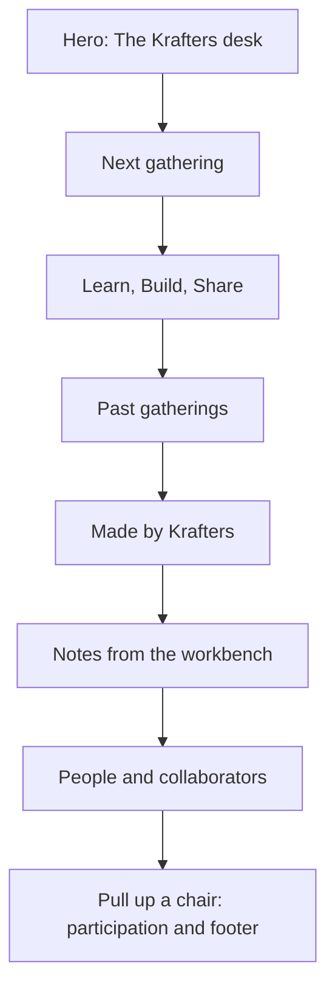

# KrowdKraft website: reference analysis and section-by-section design plan

> Historical research from 14 October 2026. The owner subsequently authorized implementation and replaced the dark palette and account product with the 15 October cream/glass direction. [DESIGN.md](../DESIGN.md), [BUILD-CONTRACT.md](BUILD-CONTRACT.md), and [IMPLEMENTATION-STATUS.md](IMPLEMENTATION-STATUS.md) describe the current site. Statements below about unbuilt work are preserved as the original planning context.

14 October 2026 · Researched proposal · Local planning only

## Recommended direction

Create **The KrowdKraft Workshop**: a memorable, interactive isometric desk that opens into a clear community website. The flagship object is Anatomy's desktop computer, carefully rebranded for KrowdKraft. A mechanical event printer and an optional reading stand form a small, consistent family of original illustrations. Real event material, people, and articles provide the rest of the page's substance.

The visitor should understand three things immediately: KrowdKraft is a Bengaluru developer community; Krafters learn, build, and share together; there is a clear way to find a gathering or follow community updates. The artwork should make that invitation distinctive.

Both references use a viewport-sized interactive world, with application-like state changes rather than a conventional sequence of scrolling homepage sections. This proposal adapts their strongest ideas into a normal scrolling website with a distinctive interactive opening. A full 3D community world remains a possible expansion with its own scope.

This is a design and implementation plan, not an approved replacement application. No framework is selected, no application or adapted illustration has been built, and no commit, push, or deployment is included.

## 1. What the references actually do

### Dwayne Koh: a place that acts as an index

The inspected opening is a dark, three-dimensional lantern pavilion surrounded by blossom trees, drifting petals, water, and reflections. Project identities are integrated into the building's signs. The sparse outer interface includes a project navigation row, an index control, a cassette/audio control, and Lantern/Chroma choices. Shipped camera code supports drag orbit; wheel input was observed zooming rather than advancing a long document. A right-side HTML index provides a direct route through projects, archive, about, awards, and other content.

Its important design mechanism is the relationship between **a memorable place and an ordinary index**. Visitors can explore an object in the world or use familiar text navigation. The warm central light against a very dark background makes the building the obvious focal point. Peripheral details reward exploration without all demanding equal attention.

Public shipped code inspected during the study identifies Three.js and OrbitControls. Those findings explain the live camera behavior; they do not mean KrowdKraft needs the same implementation. See the [Dwayne analysis](research/2026-10-14-design-study/dwayne-analysis.md) for observed flows, resource evidence, mobile coverage, and limitations.

A representative project detail changes to cream editorial pages, fine rules, a chapter rail, and large media plates. On a 390 px viewport, the main world is reframed and the desktop project links become a hamburger. These are useful separate lessons: make the opening expressive, then let long-form information become calm and legible.

**Transfer to KrowdKraft:** give the community a recognizable place; make selected physical objects correspond to real content; retain direct text navigation; use illumination and material detail to guide attention. The new place can be a Bengaluru builder's desk, with an event slip, notebook, demo screen, and small community badge. It should have its own silhouette and story.

### Cyera: a coherent world with chapter-based progression

The inspected opening uses a purple illustrated space environment with outlined faceted rocks, a helmet-like form, lime/pink accents, fine grain, a large central white headline, and a clear Begin Your Mission action. The journey transitions through narrative scenes into a Discover / Govern / Protect world-selection interface. The persistent outer navigation keeps the commercial destination available. The Discover scene, pointer-driven camera movement, and keyboard activation of a topic object were exercised. Public code and DOM evidence reveal optional games and later conversion states; the source report distinguishes those from the states actually reached in the browser.

Its most transferable quality is **consistency**: shapes, colors, outlines, typography, transitions, and interaction feedback all belong to one world. A chapter has one central idea and one next action. The visual changes reinforce the story instead of merely decorating it.

See the [Cyera analysis](research/2026-10-14-design-study/cyera-analysis.md) for the tested journey, implementation evidence, phone layout, and unresolved gameplay coverage.

The implementation evidence points to Hydra/custom WebGL, TheatreJS, Flicking, and Draco decoding. It does not establish a React, Next.js, or Three.js application. On a narrow viewport, the interface uses a compact brand icon/menu and vertically recomposed scenes; the captured phone images include animation samples rather than every settled state.

**Transfer to KrowdKraft:** organize the story around Learn, Build, and Share; let deliberate choices change a small part of the illustration and its nearby content; use one art system across sections. Community events and joining should remain directly available throughout that story.

### Synthesis

| Design dimension | Dwayne contribution | Cyera contribution | KrowdKraft interpretation |
| --- | --- | --- | --- |
| Spatial identity | A recognizable destination | A consistent fictional universe | One coherent maker's workshop |
| Composition | Lit object surrounded by quiet space | Large readable headline over an environment | Large text plus a detailed desk, with breathing room |
| Navigation | World exploration plus text index | Guided progression plus persistent external CTA | Ordinary navigation plus optional object interactions |
| Story | Projects discovered within a place | Distinct narrative chapters | Learn, Build, Share, supported by actual community activity |
| Motion | Camera movement, ambient life, reflections | Transitions and task feedback | Key travel, CRT power, paper feed, short section reveals |
| Conversion | Open a project | Explore, then request a demo | Find an event, follow updates, share work, collaborate |
| Technical cost | True 3D world and substantial assets | WebGL narrative, multiple scene/game states | Static-first SVG with bounded interaction; optional WebGL later |

The two references should guide original composition and behavior. Their models, textures, project logos, music, copy, and branded scenes are not proposed production assets.

## 2. Art direction and visual rules

**Working concept:** a thoughtful, slightly playful workshop after hours. The computer is the visual signature, and the page feels like an invitation to pull up a chair and make something. Use physically plausible objects with precise seams, keys, screws, cables, recesses, shadows, and controls.

**Suggested color direction, for review:** a charcoal foundation, warm off-white text, muted graphite or warm grey hardware, and concentrated cyan/amethyst light. Preserve the KrowdKraft logo's full color. The previous black/amethyst/cyan palette is a starting reference, not a newly approved requirement. Try one dark and one warm-light still composition before locking tokens. Do not implement two full website themes merely because Dwayne offers two worlds.

**Typography:** test the retained Manrope font for headings and body copy. Use a restrained monospace treatment only for short terminal/readout text. The retained Yatra font may suit a small local or editorial accent if it remains readable; it should not compete with the main type system. Preserve supplied font licenses. No em dashes in published website copy or the browser title.

**Layout:** use a consistent content width around 1200-1280 px on large screens, a 12-column desktop grid, generous section spacing, and readable body lines. Start hero type around 64-88 px on large screens and 36-44 px on phones, then adjust to real line wrapping. These are design starting points, not validated specifications. Prefer a mix of one large figure, broad editorial rows, authentic posters, and quiet text blocks over identical card grids in every section.

**Material consistency:** match projection, outline weight, corner treatment, lighting direction, shadow softness, and scale across the figure collection. Fine grain can be a subtle static overlay; it must not reduce text contrast. A single physical duck sticker or desk toy can use the retained mascot if chosen. Keep it subordinate to the computer.

**Motion:** a short welcome typing sequence, keys that visibly depress, an intentional CRT power toggle, and paper advancing after an event selection. Use short opacity/position reveals for supporting content. Initial proposal: roughly 160-240 ms for controls and 450-650 ms for a larger object change, with timings tuned through review. The page should settle between actions. Sound is unnecessary for the initial design; any later sound needs a deliberate opt-in.

## 3. Homepage sequence

The normal reading order is: identity, next opportunity, community purpose, evidence of past activity, things made, useful reading, people, and participation. This intentionally puts event access early. A first-time visitor can browse the story; a returning visitor can go straight to a destination.

### 0. Persistent header

- **Purpose:** give visitors immediate orientation and useful destinations.
- **Layout:** owned mark and KrowdKraft wordmark on the left; Events, Community, Journal, and a primary Get updates link on the right. Add Builds when there are approved entries or a meaningful submission destination. Use a compact menu on smaller screens.
- **Behavior:** header stays available as the page scrolls. Active section highlighting is optional; all destinations are actual links. A small scene index may mirror the same links, but there is no second competing navigation system.
- **Mobile:** an accessible menu with visible close control, Escape support, focus return, and large touch targets. The page remains scrollable normally.

### 1. Hero: The Krafters desk

**Job:** say who KrowdKraft is and give the website its memorable signature.

**Proposed copy**

> Bengaluru's builder community
> Where what if becomes look what I made.
> Learn with curious people, build useful things, and share what you make.

**Composition:** text occupies approximately five desktop columns; the isometric computer occupies seven. Keep the main heading clear of the keyboard and screen. A muted floor plane and grounded shadow give the hardware presence. The computer shows the actual KrowdKraft logo, with a short welcome prompt. A small badge, notebook, cable, or duck sticker can establish personality without making the scene crowded.

**Actions:** Explore events and Get community updates, in ordinary HTML. A small Try the keyboard control introduces the optional interaction. If the current event's registration is closed, the hero still links to its information and the broader calendar, without implying registration is open.

**Interaction:** the welcome sequence types `hello, krafters`, then rests. Visitors can type a bounded local message, clear it, toggle the physical power control, or replay the demonstration. The interface must explain that this is an interactive illustration. It is not a shell, AI assistant, membership signup, or server submission. A small Events object may focus or scroll to the next section, with the same destination available as a text link.

**Mobile and fallback:** heading, community description, actions, then a fitted static-first computer. Use a native text input for typing; tiny SVG keys are visual feedback, not the primary mobile keyboard. Keep the hero within a sensible first-screen-plus-illustration height instead of clipping it to a rigid viewport. Reduced motion shows a stable lit screen. Without JavaScript, the illustration and all content remain readable.

**Source of inspiration:** Dwayne's illuminated central subject; Cyera's clear headline and entry action; Anatomy's real object mechanics.

### 2. Next gathering: a real invitation

**Job:** turn interest into a concrete opportunity to meet.

**Composition:** a broad event panel combining the real event banner, title, date/time, venue, short description, and a clear state label. An original compact agenda printer sits beside or below it, feeding a small paper slip. Keep long event details in HTML, not rendered as tiny SVG text.

**Example from the verified 14 October snapshot:** Hacktoberfest Hack Day is scheduled for 18 October 2026, 08:30-18:30 IST at Startup Park. The stated registration deadline is 7 October. Its card should read Upcoming and Registration closed, with View event details / Participant information. A generic register button on an external host must not override the explicit deadline or imply a reopened signup. Recheck organizer information before publication.

**Interaction:** selecting another real event advances the paper and changes the adjacent content. The button destination comes from that event's record. No endless carousel. Where there is only one upcoming event, show one stable card.

**Empty state:** No upcoming gathering announced. Link to the archive and community updates. An idle printer can hold a truthful blank agenda or `next gathering soon`, clearly presented as a placeholder message rather than a dated promise.

**Mobile:** event information and action first, poster next; printer becomes a small static accent or is omitted. Date/time and registration status must remain visible without operating the artwork.

### 3. Learn, Build, Share: what happens here

**Job:** explain the community in concrete terms.

**Composition:** three generous editorial rows or tabs with short descriptions and actual destinations. Learn links to workshops and notes; Build links to hack days and approved projects; Share links to demonstrations and a genuine contact channel. Keep copy specific: workshops, experiments, team projects, demos, and practical notes.

**Art and behavior:** use three small objects derived from the same desk, such as a notebook, tool, and presentation card. Selecting an HTML tab highlights the related object and updates the nearby text. This borrows Cyera's chapter clarity. A fully articulated three-station maker bench is an optional later Hero illustration, not required in the initial art set.

**Mobile:** display three stacked items or an accessible tab pattern with all essential information reachable. No swipe-only control, timed quiz, or progress requirement.

**Content boundary:** descriptions should reflect what organizers can actually support. Do not imply a daily schedule, guaranteed mentorship, hiring placement, or a permanent physical workspace unless confirmed.

### 4. Gatherings that made things happen

**Job:** demonstrate that KrowdKraft is an active community through its real history.

**Composition:** a featured image/story pair followed by a compact chronological list or two supporting cards. Prioritize the x402 PreHack, Into the AI-Verse, and other retained events. Show title, date, location, relationship, and a real source or recap link. Provide All events with useful type/year filters on the archive page.

**Art:** actual posters and verified event photography carry this section. Use a quiet frame or paper-pin detail from the workshop language. Do not replace community evidence with generated crowds. Records without images can use an intentional typographic treatment.

**Interaction:** short hover/focus emphasis and real detail links. An optional photo viewer needs captions, close control, focus management, and usable touch navigation. The initial section does not require a dragging photo wall.

**Mobile:** a simple vertical flow. Keep dates and captions legible. Avoid a horizontal strip whose important cards remain hidden offscreen.

**Provenance:** some historical events survive in repository snapshots, while the recent MLH and Luma pages were checked live. Label the source and avoid treating old records or displayed RSVP counts as measured attendance.

### 5. Made by Krafters

**Job:** connect the community's promise to things its members have actually made.

**Composition:** one generous featured project and up to two smaller entries. Each needs a real title, creator credit, short problem/result description, image, and repository or demo link. Tags may describe the actual technology or topic.

**Optional art:** an original compact demo turntable or display cabinet. Selecting a verified project changes its placard and the nearby HTML content. For the initial release, well-presented real project screenshots are sufficient; a fourth custom illustration is not essential.

**Current content gap:** the retained material inspected contains no approved member-project collection. Prepare the section design and schema, but publish either an honest Share something you made invitation with an email link or approved projects supplied later. Do not populate it with invented member names, repository activity, or screenshots.

**Mobile:** one project at a time in a normal vertical list, with visible author and destination. No miniature monitor that must be opened to discover the actual link.

### 6. Notes from the workbench

**Job:** give visitors a reason to return between events.

**Composition:** an editorial article list, with one larger selected note and two supporting rows. The retained titles include Are online certifications worth it?, Dev vs DSA, and The opportunities off your radar. Show the author, historical publication date, topic, and a short original description.

**Optional art:** a small document camera/reading stand with one illuminated sheet. Hover or focus on an article can highlight a corresponding page. The real article title remains selectable text outside the drawing.

**Actions:** Read on Medium with a clear external destination. A /journal archive can organize excerpts and links; full article republication is not assumed.

**Mobile:** a readable list with consistent metadata. No automatic page-flipping carousel or pretend recent publication dates.

### 7. People behind the community, and collaborators

**Job:** make the invitation personal and trustworthy.

**Composition:** a short founder/organizer introduction and three straightforward profiles for Darshan Krishna N, Deepak N, and Viha Shomikha, using the retained Community organizer role unless updated. Use real approved portraits when supplied, or a deliberate name/initial treatment. Follow with an event-linked collaborator row.

**Relationship language:** use concrete labels such as Hosted with, Venue partner, or Powered by where a particular event's source supports them. MLH, Startup Park, AlgoBharat, HackCulture, Algorand, Keploy, and venue names have different relationships in different records. A single undifferentiated sponsor logo wall would overstate that evidence.

**Art and behavior:** keep this section human and quiet. A small shared desk badge is enough. Links should lead to supplied organizer profiles, an event page, or email. Do not infer social handles or generate portraits.

**Mobile:** profiles become a simple stack; partner labels remain attached to the relevant event or relationship.

### 8. Pull up a chair: participation and footer

**Job:** end with a clear next step for each visitor.

**Composition:** a large invitation, a small static return of the branded desk or logo badge, and three practical choices: Get community updates, Attend a gathering, and Share an idea or collaborate. A short line explains each destination.

**Destinations:** the retained WhatsApp URL is a public channel for updates, so label it Follow the WhatsApp channel rather than Join our group chat. Events link to the internal calendar and verified external event hosts. Collaboration/project proposals can open `mailto:krowdkraft.official@gmail.com` with an appropriate subject. The supplied event participant group is event-specific, not the general community destination.

**Footer:** owned logo, Bengaluru context, navigation, supplied social links, contact email, and relevant legal/privacy information for whatever features are eventually implemented. Reuse a static asset rather than a second live computer instance.

**Mobile:** vertically stacked actions with descriptive labels. The final call to action should fit without a large empty cinematic scene.

## 4. Anatomy computer adaptation specification

The installed desktop example is a 600 x 440 SVG scene with approximately 85 solids, 850 paths, and 58 modeled keys. It contains a screen-plane transform, CRT recess, key travel, and a power-collapse effect. The rebrand is feasible, but replacing only the visible logo would leave demo-specific text and behavior behind.

| Area | Planned adaptation |
| --- | --- |
| Screen identity | Replace hardcoded Anthropic paths with the owned clean `assets/logo.png` mark, or an approved faithful vector version. Preserve aspect ratio and fit it within the screen plane and clipping. |
| Body identity | Add a small KrowdKraft case badge or decal; keep hardware mostly tonal so the screen mark remains clear. |
| Text | Replace demonstration phrases, card title, caption, legend, accessible label, and page metadata. Proposed short lines: `hello, krafters`, `learn. build. share.`, `made in bengaluru`. |
| Input | Bound input to the fitted screen capacity; provide clear, native controls. Keep typing local to this illustration. |
| Tour | Stop the demo after visitor takeover. The example restarts after nine seconds and erases visitor text; the adapted version should preserve it until Clear or leaving the page. |
| Power | Restrict power toggling to a named control and the rocker's hit target. The example makes the broad computer case clickable. |
| Embedding | Scope document-global selectors to each instance and make SVG IDs unique. Keep static geometry separate from per-frame updates. |
| Accessibility | Pause on focus/hover where appropriate; provide a stable reduced-motion version and respond to preference changes. Expose one useful figure description rather than hundreds of paths. |
| Legal/provenance | Preserve the Anatomy MIT copyright and permission notice with reused code. Use owned brand artwork and newly drawn supporting figures. |

The clean mark is preferable to the large `assets/KrowdKraft_Logo.png` rendition, which has a surrounding glow/background that would compete with a small CRT. No canonical vector mark was found among the obvious retained logo assets. Raster embedding is a valid initial choice; any vector recreation should preserve the original identity and be reviewed.

Recommended initial figure set:

1. **The Krafters desk:** flagship interactive Hero, adapted from the installed computer.
2. **Gathering printer:** original Figure with rollers, paper feed, controls, seams, and a grounded base; tied to real event selection.
3. **Reading stand/document camera:** optional original Figure if the article section benefits from it after real content is placed.

Each companion needs an explicit object/component inventory and state diagram before drawing. Anatomy's Figure guidance calls for roughly 40-80 purposeful components; Hero guidance is roughly 80-150. Complexity should come from the mechanism's structure. A whole animated community building would be a separately scoped Epic.

See the [detailed Anatomy adaptation and integration plan](research/2026-10-14-design-study/anatomy-plan.md) for exact source locations, state transitions, craft checks, license details, and known example limitations. In particular, the supplied desktop builder does not implement an `--audit` command; passing that flag would not prove geometry validation.

## 5. Information architecture and content behavior

| Destination | Proposed content and behavior | Initial data |
| --- | --- | --- |
| `/` | The section sequence above | Retained community facts and curated records |
| `/events` | Upcoming and past events, real filters, useful empty states | Seven retained records, refreshed before publication |
| `/events/[slug]` | Full event information, registration state, source, venue, related history | Known event fields; no invented agenda or attendance |
| `/journal` | Attributed article excerpts and external destinations | Three retained article records |
| `/join` | Clear channel/calendar/contact choices, no implied account creation | Owner-supplied and checked links |
| `/#community` | Learn/Build/Share plus organizers | Retained community description and organizer names |
| `/#builds`, later `/builds` | Approved project showcase or honest submission invitation | Requires real project content |

These are proposed URLs and content responsibilities, not a chosen router/framework. A dedicated Community or Collaboration page can be added when there is enough useful content. Avoid creating empty pages simply to expand navigation.

**Content ownership:** keep one canonical structured record per event, article, organizer, project, and relationship. Start with the retained files as editorial inputs; they are snapshots, not automatically synchronized feeds. Add a `lastVerifiedAt` and source/provenance field where appropriate. A future CMS or live feed needs an explicit owner and update process.

**Event states:** treat lifecycle and registration independently. Lifecycle can be scheduled, in progress, ended, cancelled, or date to be confirmed. Registration can be open, closed, waitlist, unknown, or not applicable. A future start time alone does not imply open registration. An organizer cancellation or change overrides a computed date state. Unknown registration gets View official details rather than an assertion that tickets are available. Show India time clearly for local gatherings.

**Participation and authorization:** the initial proposal has no member accounts or pretend membership database. Browsing public content requires no sign-in. Event hosts handle their own registration. A mail link opens the visitor's email application and must not display a fake sent state. If in-site submissions or editing are later selected, design persisted submission records, organizer-only publishing, validation, moderation, error states, and abuse controls before building those features.

**Truthful states:** expired events move into the archive, missing images receive designed fallbacks, zero approved projects receive a submission invitation, and unavailable external services get a clear alternative. Do not show fabricated counters, real-time presence, ticket scarcity, testimonials, sponsors, or activity feeds.

### Event detail and archive page treatment

Adapt Dwayne's editorial detail-page rhythm into a warm, highly readable event page: identity and status first, a large real banner, a concise overview, confirmed agenda/speakers when available, venue details, and a source/registration action. Past events can add an authentic recap and credited gallery. Omit sections without real content. A simple section rail is useful on long desktop pages; use normal document scrolling and compact in-page links on phones. Returning to the archive should preserve its filters and approximate reading position. The same type, thin rules, restrained accent, and branded header connect this quieter layout to the illustrated homepage.

The archive should show an explicit Upcoming/Past distinction, real type/year filters, an intelligible zero-results state, and stable detail URLs. Individual pages need meaningful titles, descriptions, share images, and crawlable event text. Any structured event metadata must match visible dates, venue, and status; it must not manufacture availability, reviews, or attendance.

## 6. Technical approach, accessibility, and performance

The recommended first implementation is **semantic HTML with static-first SVG figures and small interaction modules**. Anatomy supports framework-free SVG, so the plan does not depend on choosing React, Next.js, or another framework. Select the application framework after confirming routes, content editing, forms, and persistence needs.

A fixed isometric SVG cannot reproduce Dwayne's free camera or Cyera's full 3D travel. It can provide coherent depth, tactile controls, stateful mechanisms, limited parallax, and polished transitions. If unrestricted camera movement or a complete walk-through workshop is essential, choose a separate WebGL art pipeline with original models, texture budgets, camera states, and a static fallback. Do not present the two approaches as equivalent in scope.

| Concern | Planned requirement |
| --- | --- |
| Content loading | Deliver heading, description, navigation, event content, and CTAs without waiting for illustration initialization. No mandatory cinematic intro. |
| Motion lifecycle | One active animation loop at most where practical; stop when settled, offscreen, or the tab is hidden. Lazy-load supporting interactions. |
| Responsive layout | Check 360/390 px phones, tablet, 1440 px desktop, and a wide screen. Recompose text/art instead of just shrinking desktop. |
| Touch | Preserve vertical scrolling; provide named buttons and native input; no wheel capture or drag-only destination. |
| Keyboard | Logical order, visible focus, Escape for overlays, focus return, and no keyboard trap in the terminal. |
| Reduced motion | Static initial artwork, instant state changes, no automatic typing/scanline drift/cursor blink/camera movement. All useful actions remain available. |
| Screen readers | Landmarks, headings, descriptive link text, real form labels, concise figure description, deliberate state announcements only. |
| Visual access | Verify text/control contrast, zoom/reflow, sufficiently large touch targets, and status labels that do not depend only on color. |
| Failure fallback | Useful HTML and static art with scripts disabled, animation errors, or unavailable WebGL. |
| Media | Responsive image sizes; preserve real poster details; load below-fold images when needed; avoid reusing full-resolution decorative assets. |
| Third parties | Prefer normal links to heavy social/event embeds. Add analytics or forms only when their purpose and data handling are decided. |

Proposed performance acceptance targets are LCP at or below 2.5 seconds, INP at or below 200 ms, and CLS at or below 0.1 at the 75th percentile once there is enough real traffic, segmented by desktop and mobile. These thresholds follow [Google's Core Web Vitals guidance](https://web.dev/articles/vitals). For local review, establish reproducible phone/network lab checks and compare the same scenarios before and after art integration. These are targets, not achieved measurements; a load-only Lighthouse run does not establish field INP. Keep initial compressed JavaScript around 150 KB or less if practical for the selected architecture, with the figure's actual markup and media cost budgeted separately. Revise budgets consciously after a measured vertical slice, rather than adding multiple heavy scenes first.

The source examples' disk/resource sizes are diagnostic context, not a forecast for KrowdKraft. Download size alone does not establish runtime frame rate, battery use, accessibility, or loading experience.

## 7. Implementation sequence and review outputs

| Phase | Work | Reviewable output / completion condition |
| --- | --- | --- |
| 1. Content and behavior | Confirm routes, event lifecycle/registration rules, CTA destinations, content ownership, project gaps, and whether forms exist | Route map, content inventory, state tables, and authorization boundaries agreed before visual polish |
| 2. Visual concept | Produce two still hero treatments using the real mark; choose palette, type, composition, and object style | Desktop and phone stills; one chosen direction; approved figure inventory |
| 3. Vertical slice | Build the branded computer, hero text/actions, and one actual event panel | Working desktop/phone preview with keyboard, touch, reduced motion, static fallback, and correct event status |
| 4. Full page and routes | Add community explanation, archive, journal, people, participation, and approved projects; create printer and optional reading figure | Every link and content state works; no placeholder facts or fake submissions |
| 5. Verification and refinement | Inspect branding at high zoom; test art states, rapid power reversal, focus, phone reflow, event boundaries, image loading, and performance | Screenshots and concise evidence of passed checks; remaining limitations explicitly recorded |
| 6. Owner review | Present the complete local website and content checklist | Requested changes incorporated; any deployment is a separate explicitly authorized action |

This is a multi-stage website build. Anatomy's example illustration estimates do not establish a whole-site delivery estimate. The adapted computer, original companion figures, real content preparation, responsive design, interaction work, and verification should be estimated separately after the visual direction is selected.

## 8. Decisions and missing content for the next build brief

- **Art direction:** approve the Workshop concept and a still palette/layout treatment. The recommendation is one interactive computer and one supporting printer, with the reading figure optional.
- **3D ambition:** choose fixed isometric SVG for the initial design, or explicitly expand scope to a true 3D environment. The recommended plan uses SVG.
- **Brand:** confirm the clean owned logo and whether a faithful vector asset exists elsewhere. The retained caption is a proposal for reuse, not a newly approved tagline.
- **People and work:** supply approved portraits, profile destinations, real member projects, creator permission, and authentic event photos where available. Text-only fallback layouts remain useful while these are missing.
- **Event operations:** identify who refreshes dates, deadlines, cancellations, and source links. The 14 October study should not freeze a launch page's event status.
- **Relationships:** confirm the wording and logo use for event partners. Historical association does not imply a current general sponsorship.
- **Participation:** start with the supplied channel, calendar, and email destinations. If an internal form or membership system is wanted, include its data and moderation requirements in the build brief.

These are items for the future implementation brief. They did not prevent completing the current research and section plan.

## 9. Evidence, sources, and coverage

The study combines REA inspection of the public browser targets and shipped scripts, active Playwright interaction, screenshots, local Anatomy source inspection, and retained repository content. REA observation is passive; navigation, clicking, typing, scrolling, and viewport changes were performed through browser automation. Public code was used to explain mechanisms, not to claim unseen interactions completed successfully.

Detailed reports:

- [Dwayne Koh: observations and mechanism analysis](research/2026-10-14-design-study/dwayne-analysis.md)
- [Cyera: narrative, interaction, and mobile analysis](research/2026-10-14-design-study/cyera-analysis.md)
- [Anatomy: rebrand, original figures, state model, and integration caveats](research/2026-10-14-design-study/anatomy-plan.md)

Representative visual evidence:

- [Dwayne opening](research/2026-10-14-design-study/dwayne/01-desktop-initial.png)
- [Dwayne text index](research/2026-10-14-design-study/dwayne/05-index-settled.png)
- [Dwayne editorial project detail](research/2026-10-14-design-study/dwayne/09-detail-top.png)
- [Dwayne at phone width](research/2026-10-14-design-study/dwayne/11-mobile-home.png)
- [Cyera opening](research/2026-10-14-design-study/cyera/desktop-initial.png)
- [Cyera chapter selection](research/2026-10-14-design-study/cyera/desktop-world-select.png)
- [Cyera at phone width, during its hero animation](research/2026-10-14-design-study/cyera/mobile-home.png)

| Research question | Coverage |
| --- | --- |
| What makes each reference distinctive? | Answered through actual desktop captures and public styling/mechanism evidence |
| How do navigation and transitions work? | Representative flows answered; Dwayne's final Chroma/Leonardo world states and Cyera's game completion remain unverified |
| What changes at phone width? | Responsive layouts captured at 390 px; physical-device touch, frame rate, and complete mobile menus were not validated |
| Can the Anatomy desktop be branded? | Source and logo inspection answered this; an adapted browser implementation has not yet been built |
| What should each KrowdKraft section contain? | Detailed proposal provided above, grounded in inspected community content and clearly identified content gaps |
| Can the visual direction be recreated? | Feasible approach specified for original SVG art and optional 3D expansion; no pixel-perfect clone or measured production performance claimed |

Primary external sources:

- [Dwayne Koh](https://www.dwaynekoh.com/)
- [Cyera: Secure the Unknown](https://secure-the-unknown.cyera.com/)
- [Official MLH Hacktoberfest Hack Day listing](https://events.mlh.com/events/15112-hacktoberfest-hack-day-bengaluru-krowdkraft)
- [Official x402 Global Challenge PreHack listing](https://luma.com/tudxpgxi)

Local content sources include `details/community.json`, `details/links.json`, `details/events.json`, `details/journal-history.json`, `details/brief.md`, asset provenance, the retained logo/font/image files, and the installed Anatomy skill/example/license. The public WhatsApp channel destination is owner-supplied. The full Luma community calendar was not independently verified in this study.

The individual reports carry REA evidence identifiers and exact observation limits. This is a thorough bounded design investigation, not a complete reconstruction of either site's private source, authoring files, backend, every possible game outcome, or behavior on physical mobile devices. The plan's layouts, palette values, new figure concepts, routes, and performance budgets are proposals. Only the reference observations and inspected local facts are presented as verified.
